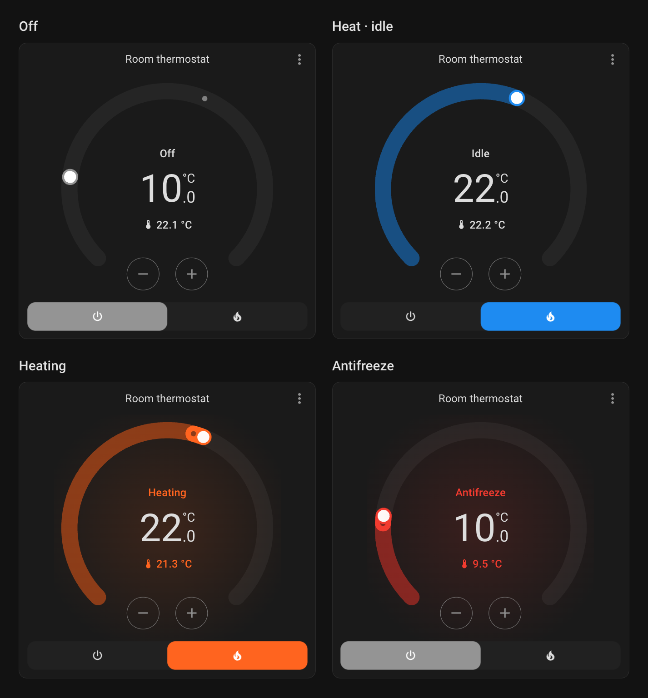
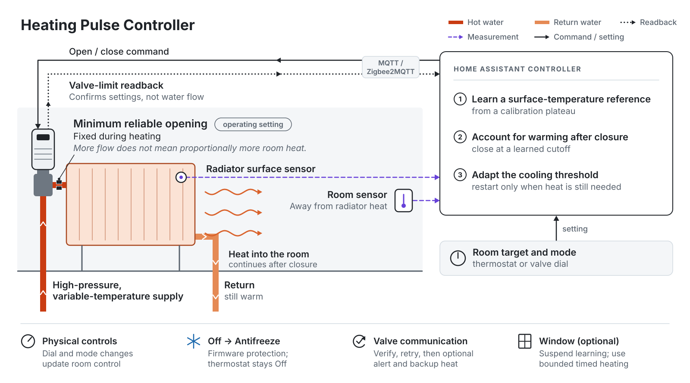
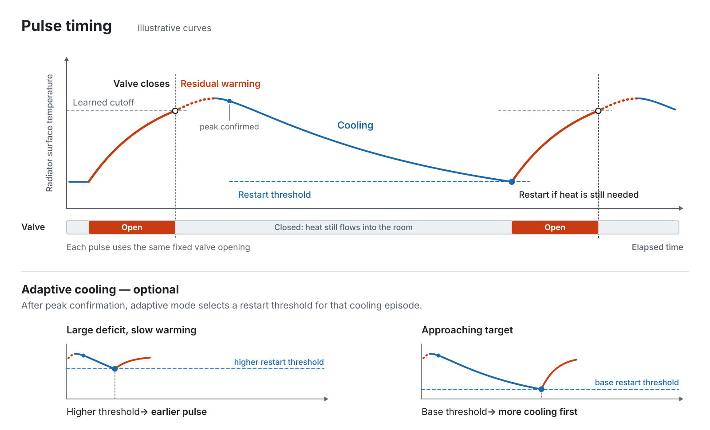
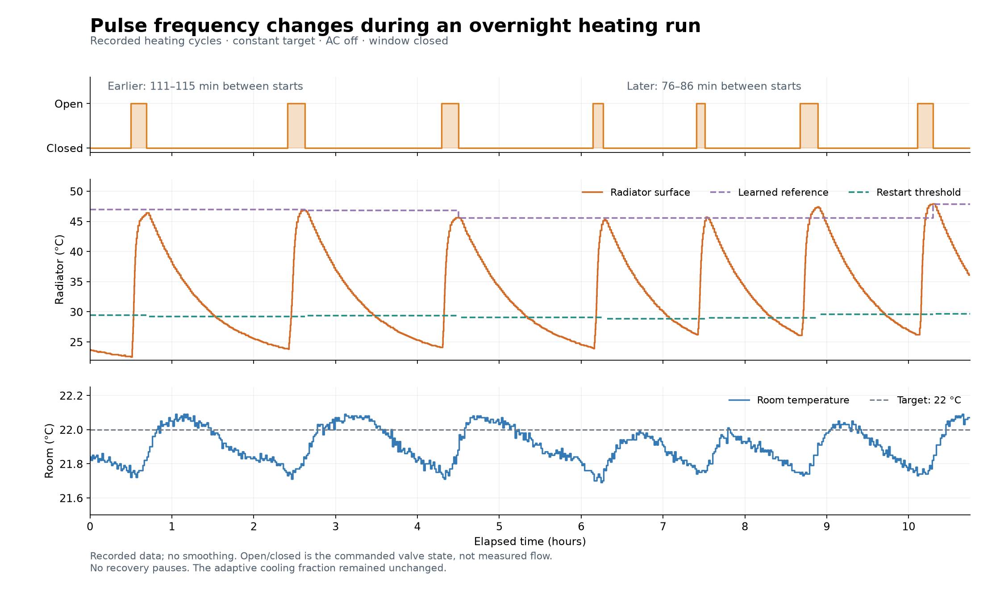

# Heating Pulse Controller

Radiator heating in short pulses, controlled by Home Assistant.

Heating Pulse Controller learns how each radiator heats up and cools down, then uses that behaviour to control the valve:

- **Make use of stored heat.** Anticipate the temperature rise after valve closure and close early, letting the radiator continue heating the room.
- **Short pulses at minimum opening.** Use the valve's smallest reliable opening that provides enough flow to heat the radiator quickly, then close it while the radiator releases its stored heat.
- **Adapt to each radiator.** Learn from its heating and cooling response, and refresh calibration as the hot-water supply temperature changes.
- **External room temperature feedback.** Control heating using a separate room sensor rather than the temperature measured beside the valve.
- **Use radiator temperature feedback.** Measure the radiator surface to decide when to end a pulse and when it has cooled enough to heat again.
- **Window sensor support.** With a window sensor configured, suspend thermal learning and limit heating while the window is open.
- **Configurable duty cycle and cooling thresholds.** Set a maximum duty cycle and tune how far the radiator cools between pulses. Optional adaptive cooling shortens that wait when the room is warming too slowly.
- **Diagnostics in Home Assistant.** Inspect learned temperatures, valve commands and decision reasons.

[](https://github.com/blackeyeliner/heating-pulse-controller-v2/actions/workflows/check.yml)
[](https://github.com/blackeyeliner/heating-pulse-controller-v2/releases)

[Install](#installation) · [How it works](#how-it-works) · [Operating guide](docs/operation.md)

[](docs/assets/thermostat-card-states.png)

*A custom thermostat card developed for this integration, based on Home Assistant's standard card. It keeps the native look and controls while adding controller-specific state colours and frost-protection display. Antifreeze shows firmware heating while the room thermostat remains Off.*

## What you need

| Component | Requirement |
|---|---|
| Home Assistant | 2026.9.0 or later |
| Radiator valve | **Sonoff TRVZB through Zigbee2MQTT**, with opening and closing limit entities |
| Room temperature | An external sensor away from the radiator's heat |
| Radiator temperature | A sensor attached to the radiator surface |

Both sensors must report fresh Celsius measurements **even when the temperature hasn't changed**. Otherwise, the controller cannot tell a steady temperature from a sensor that has stopped reporting. See [sensor hardware and reporting setup](docs/installation.md#sensor-hardware-used).

**Currently in beta.** Start with one radiator and observe a complete heating and cooling cycle before adding more.

## Why pulse control?

A radiator keeps heating the room after its valve closes. With a high-pressure supply, even a small valve opening can heat it quickly. Meanwhile, the temperature beside the valve may be quite different from the temperature where people sit.

This controller measures both the room and the radiator. It uses the valve's **minimum reliable opening**, then controls how long it stays open and how much the radiator cools between pulses. You can inspect its learned temperatures, valve commands and decision reasons in Home Assistant.

[](docs/assets/heating-system.svg)

## How it works

1. **Learn the radiator.** During calibration, let it heat until its temperature levels off. This establishes a reference for the current supply conditions.
2. **Close before the peak.** Learn from the warming that continues after closure and use it to choose an earlier cutoff for later pulses.
3. **Let it cool.** Wait until the radiator reaches its cooling threshold. Another pulse starts only if the room still needs heat and any duty-limit pause has elapsed.

[](docs/assets/heating-cycle.svg)

*Illustrative curves. The lower panels show alternative room conditions, not measured results.*

Calibration is refreshed periodically, and ordinary pulses check for cooler supply water. Optional **adaptive cooling** allows another pulse sooner when the room is below target and warming too slowly. It is off by default.

[Full algorithm and state transitions →](docs/architecture.md)

## Features

- **Physical controls:** turn the TRV dial to change the room target. Supported firmware mode changes also switch heating off.
- **Frost protection:** Off hands heating back to the TRV's antifreeze mode and preserves your normal heating target.
- **Window input:** pause thermal learning and use limited heating pulses while a configured window is open.
- **Duty limits:** choose 50%, 33% or 25% from a per-room dropdown, or leave ordinary pulsing uncapped.
- **Valve checks:** read back both valve limits after commands and during heating; correct settings that have drifted.
- **Recovery:** use limited fallback heating when temperature data or calibration fails. A confirmed valve failure can trigger a notification and configured backup heating.
- **Restart support:** retain the mode, target and compatible learned settings. Verify the valve and fresh sensor readings before resuming.

[Controls, settings and diagnostics →](docs/operation.md)

## Installation

1. In HACS, open **Custom repositories** and add:

   ```text
   https://github.com/blackeyeliner/heating-pulse-controller-v2
   ```

   Select **Integration** as the category.

2. Download **Heating Pulse Controller v2**. Enable prerelease versions if needed to see the beta.
3. Restart Home Assistant.
4. Open **Settings → Devices & services → Add integration** and select **Heating Pulse Controller v2**.
5. Follow the [room setup and first-cycle guide](docs/installation.md#configure-a-room) to select sensors, check valve settings and enable control.

The integration creates a room thermostat and diagnostic entities. Add the bundled dashboard card with your thermostat's entity ID:

```yaml
type: custom:heating-pulse-thermostat-card
entity: climate.your_room_heating
```

## Recorded operation

Pulses in this run begin 111–115 minutes apart, then become more frequent at 76–86 minutes apart. Later cycles start with more heat remaining in the radiator, while the room target stays unchanged.

[](docs/assets/recorded-pulse-frequency.svg)

*Actual Home Assistant history, aligned by time. AC was off, the window was closed and no timeout recovery occurred. This shows pulse timing responding to room demand; the optional adaptive-cooling fraction remained unchanged. Temperature panels use different scales. Valve commands do not measure water flow.*

[Field observations and the v1 comparison →](docs/validation.md#duty-cycle-comparison)

## Documentation

- [Installation](docs/installation.md) — sensors, reporting, setup and the first cycle.
- [Operating guide](docs/operation.md) — daily controls, settings and troubleshooting.
- [Architecture](docs/architecture.md) — calibration, timing and device communication.
- [Design notes](docs/design-notes.md) — why the controller works this way.
- [Contributing](CONTRIBUTING.md) — development setup and reporting problems.
- [Releases](https://github.com/blackeyeliner/heating-pulse-controller-v2/releases) — downloads and version history.
