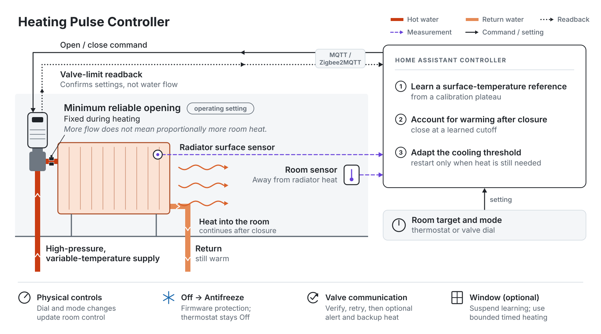
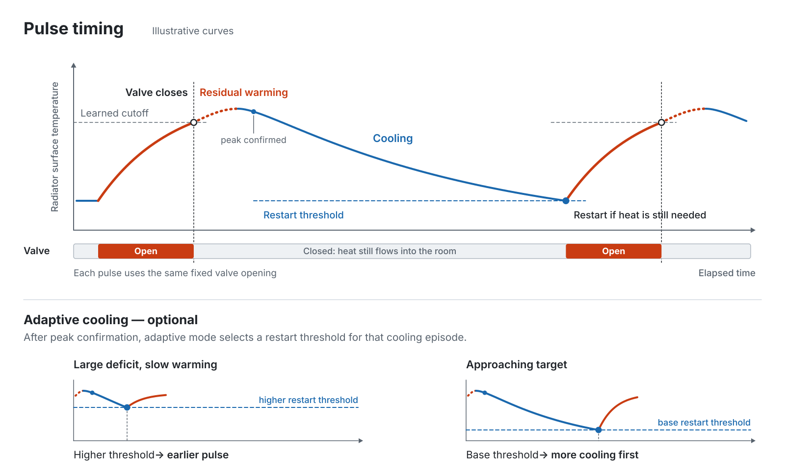
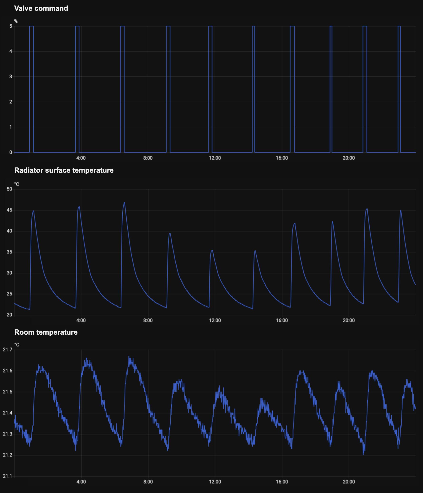
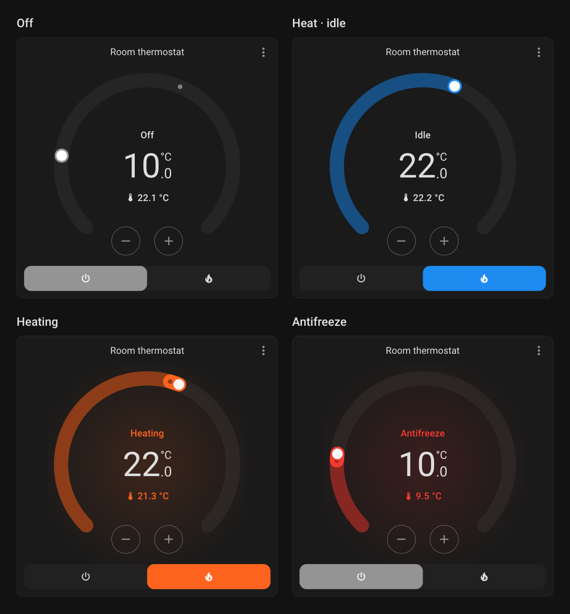

# Heating Pulse Controller

A custom Home Assistant integration for water-filled radiators, with adaptive pulse control, physical thermostat input and device-level frost protection. It learns from each radiator's heating and cooling curves to adjust pulse termination and the interval before reheating.

[Installation](docs/installation.md) · [Algorithm](docs/architecture.md) · [Design notes](docs/design-notes.md) · [Testing and observations](docs/validation.md)

## Why this was built

The controller is designed for heating systems with a high-pressure hot-water supply, varying water temperature and radiators with substantially different thermal behaviour. The objective is to maintain room temperature while avoiding unnecessary water circulation.

The operating assumption is that the smallest reliable valve opening already admits enough hot water to heat a radiator. Opening wider can increase flow faster than the radiator can transfer that additional heat into the room, sending hotter water into the return pipe. The design therefore keeps the valve at its **minimum reliable opening** during heating and adjusts when heating starts and stops. Moving below that opening introduces motor-positioning errors and can leave the valve leaking after an apparent closure.

Several other conditions make a fixed heating schedule or temperature cutoff inadequate:

- **Temperature at the valve differs from temperature in the room.** The built-in sensor sits beside the radiator and pipework. Its bias changes as they warm and cool, limiting the usefulness of a fixed offset.
- **Heat delivery continues after closure.** The surface can keep warming before reaching its peak, and the radiator continues releasing heat as it cools. A large radiator may need a much longer interval between pulses than a small one.
- **Supply temperature changes through the day.** Yesterday's cutoff can end a pulse prematurely or become impossible to reach. Radiator temperature history is needed to recognise those changes.
- **Room demand changes too.** The same radiator may need to restart sooner when the room is well below target and making little progress. Open doors, ventilation and other heaters complicate that decision.

## Adaptive heating control

Each room has a controller that combines temperature histories, the room target, its previous calibration and the state of the valve. Decisions are made by a state machine; the sensors supply measurements rather than directly switching heating.

**Calibration establishes a usable reference for current conditions.** During a needed heating pulse, the algorithm looks for sustained flattening after a meaningful temperature rise. It checks sample freshness, gaps and slope before accepting a plateau. The reference expires after three hours, while ordinary pulses continue checking for a lower plateau so cooler supply water can be recognised earlier.

**Pulse termination accounts for residual warming.** Suitable completed pulses provide an estimate of how long the surface continues warming after closure. That delay and the calibration trace determine an earlier cutoff for subsequent pulses. A pulse can also end when the room is satisfied, a plateau is confirmed, an opening limit is reached or another control condition requires closure. A single radiator-temperature reading does not decide the outcome.

**The interval between pulses adapts to the room's progress.** After peak confirmation, the controller selects a cooling threshold relative to the room temperature. In adaptive mode, a larger shortfall with little recent warming raises that threshold, allowing another pulse sooner. If the room is already warming toward its target, the algorithm allows more cooling. The adjustment is bounded, requires sufficient history and stays fixed for that cooling episode. Reopening still requires room demand; it is not scheduled for a fixed number of minutes later. Adaptive cooling is configurable and defaults to off for new entries.

*Illustrative curves, not measured data. The lower panels show alternative room conditions. One restart threshold applies throughout each cooling episode; reaching it starts another pulse only if the room still needs heat.*

[Algorithm, thresholds and state transitions →](docs/architecture.md)

### Recorded operation

The same sequence is shown below as valve commands, radiator-surface temperature and room temperature. Brief openings are followed by much longer cooling tails. Radiator peaks vary across the period, while the room temperature moves within a much narrower range.

*Actual Home Assistant history from the same time window, aligned horizontally. The temperature panels use different vertical scales. The valve chart's 0/5 signal represents closed/open commands at the configured operating point; it is not a measured opening percentage or water flow.*

### Duty cycle compared with v1

[V1](https://github.com/blackeyeliner/ha-heating-controller) pulsed a fixed low valve opening using room-temperature hysteresis, fixed radiator cutoff and restart temperatures, and a maximum opening time, checked once a minute.

Field observations put v2 at **roughly 13–15% commanded valve duty during selected regular heating runs**, compared with a reported historical average of **about 20% for v1**—approximately **25–35% less commanded-open time**. This is an observational comparison, not a matched-condition benchmark or a measurement of water or energy savings. [Measurement scope →](docs/validation.md#duty-cycle-comparison)

## Thermostat card

The bundled card keeps Home Assistant's standard temperature and mode controls, with colours that distinguish Off, Heat while idle, active heating and firmware frost protection. In Off, it displays the frost threshold while preserving the normal heating target.

*Actual card rendered in Home Assistant with demonstration values. Antifreeze indicates heating initiated by the TRV's firmware; the room thermostat remains Off.*

## Controls, protection and recovery

The Python integration provides the native room thermostat, configuration flow, diagnostic entities, persistent state and a bundled thermostat card. It replaces the earlier collection of templates, helpers and valve-writing automations.

- **Physical controls.** Turning the TRV dial updates the room target and can enable Heat from Off. Supported firmware mode changes switch it off. MQTT command echoes and retained snapshots are filtered so software writes do not become false user input.

- **Frost protection.** The controller hands operation back to the TRV's antifreeze mode with valve limits that permit firmware heating. The card displays active Antifreeze while keeping the room thermostat Off and preserving its normal heating target.

- **Open windows.** With an open configured window, thermal learning stops and heating uses up to 15 minutes on / at least 45 minutes off. Window changes switch the current pulse's termination rule without resetting its start. A room at or below 16 °C, or radiator at or below 10 °C, triggers a window-close request.

- **Valve verification.** Both Sonoff valve limits are read back after commands and monitored during heating. Configuration drift is corrected; retries preserve the original opening deadline.

- **Thermal recovery.** Missing temperature data or failed calibration uses limited fallback heating rather than leaving the room off indefinitely.

- **Backup heating.** Ten minute-spaced reconnection attempts precede an incident. A confirmed failure disables only the affected controller and can notify a phone and request selected backup climates at 20 °C.

- **Restart recovery.** Mode, target, enabled state and compatible learned settings survive updates. Startup verifies the valve and fresh inputs before resuming; an interrupted pulse is discarded.

[Operating guide and diagnostics →](docs/operation.md)

## Installation

The current adapter supports **Sonoff TRVZB through Zigbee2MQTT**. It requires the valve's opening and closing limit entities, an external room-temperature sensor and a radiator-surface sensor. Both sensors must deliver fresh Celsius readings even when the value is unchanged.

Install through HACS as a **custom repository**, then configure and observe one radiator before adding the other rooms. [Setup instructions →](docs/installation.md)

## Current status

The integration is in beta. Automated tests cover the control engine, Home Assistant lifecycle, device communication and frontend behaviour. Hardware checks have also exercised calibration, ordinary pulses, restart recovery, physical controls and firmware frost handover.

Some curves still reach the calibration timeout and remain under investigation. Recorded room temperatures and valve-open times help assess operation, but heating-water flow and delivered heat are not measured. Water, energy and cost savings have not yet been quantified. [Results and known issues →](docs/validation.md)

## Documentation

- [Design notes](docs/design-notes.md) — constraints, decisions and changes made during use.
- [Architecture](docs/architecture.md) — control heuristics, device communication and code layout.
- [Installation](docs/installation.md) — hardware requirements, HACS and the first heating cycle.
- [Operating guide](docs/operation.md) — controls, diagnostics, settings and recovery.
- [Testing and observations](docs/validation.md) — automated checks and field results.
- [Contributing](CONTRIBUTING.md) — development setup and reporting problems.
- [Releases](https://github.com/blackeyeliner/heating-pulse-controller-v2/releases) — downloads and version history.
