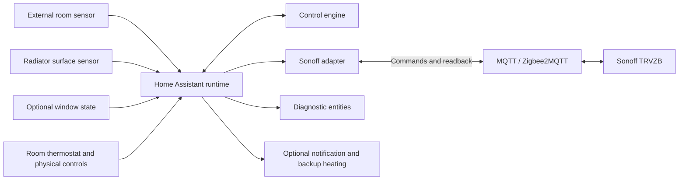
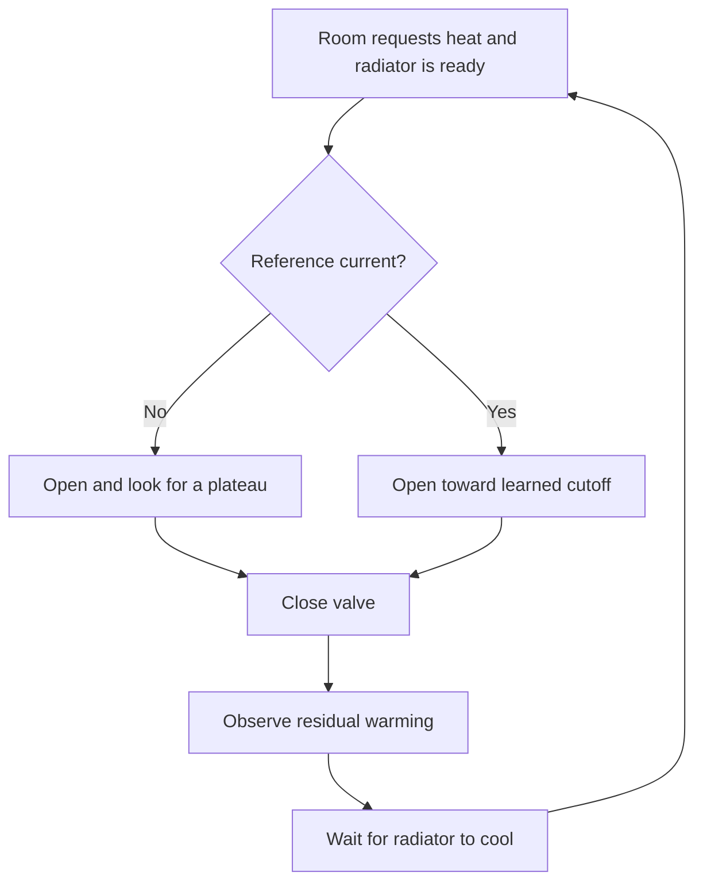

# Algorithm and architecture

[← README](../README.md) · [Design notes](design-notes.md) · [Operating guide](operation.md)

The engine evaluates temperature histories together with the room target, calibration, cooling state and opening deadlines. Fresh measurements can change its decisions, but neither sensor directly switches the valve. Ordinary heating uses an external room measurement because the valve's built-in sensor is affected by its position beside the radiator.

For the intended high-pressure supply, the minimum reliable opening already provides sufficient flow. The adapter holds that operating point during heating; regulation comes from pulse termination and the temperature conditions for reopening. Adaptive cooling can shorten the interval when the room remains well below target and recent warming is insufficient.

## System layout



The runtime handles Home Assistant events, persistence and device commands. The engine operates on timestamped measurements and has no Home Assistant imports. Normal operation keeps a bounded history in memory; it does not query Recorder.

Both temperature inputs must deliver fresh measurements while their values are unchanged. Otherwise a stable temperature becomes indistinguishable from a sensor that has stopped reporting. The optional window input is a Home Assistant cover that supports closing.

## Heating request

The room target uses hysteresis. With the default settings, a deficit greater than 0.25 °C starts a heat request; a deficit of 0.10 °C or less clears it. Between those thresholds, the previous request is retained.

A heat request does not immediately open the valve. The radiator must also have cooled below its restart threshold, and ownership, input freshness and any recovery pause must permit opening.

## Calibration and ordinary pulses



Off commands, loss of demand, input errors and opening deadlines can interrupt this sequence.

### Establish the reference

The first eligible pulse, and the first after the reference has expired, is a calibration pulse. The detector fits a slope to recent reports using their actual timestamps. It requires a meaningful temperature rise followed by sustained flattening; a cold radiator that remains cold cannot establish a reference.

A confirmed plateau supplies a radiator-surface reference. Before accepting it, the engine also checks that it can calculate a valid closing temperature from the trace. A rejected candidate leaves any previous valid calibration intact and schedules another attempt.

The reference lasts three hours. Ordinary pulses also check for a lower plateau, allowing a cooler supply to replace an unreachable reference sooner. Hotter supply is learned through scheduled recalibration, rather than inferred from the initial slope.

### Calculate the closing temperature

The surface can continue warming after the valve closes. The controller observes that delay on suitable completed pulses and uses it with the calibration trace to calculate an earlier cutoff.

Three values are kept separate:

| Value | Meaning |
|---|---|
| Reference temperature | Surface temperature accepted during calibration. |
| Closing temperature | Cutoff used for ordinary pulses, accounting for residual warming. |
| Post-close peak | Highest observed surface temperature after closure, used to assess delay and cooling. |

The post-close peak does not replace the reference. Interrupted pulses and those exposed to an open window are excluded from delay learning.

### Wait for cooling

After confirming the peak, the base restart threshold is:

```text
restart = room temperature + fraction × (radiator peak − room temperature)
```

With the default fraction of 0.30, a room at 22 °C and a radiator peak of 42 °C produce a 28 °C restart threshold. The fraction applies to the temperature difference above the room.

Optional adaptive cooling raises this threshold within bounds when the room remains below target and is warming too slowly. The chosen threshold is fixed for that cooling episode. Demand can change immediately with the target, but the threshold is recalculated only at the next confirmed peak. [Adaptive cooling calculation](next-stage.md)

## Windows, missing data and timeouts

| Situation | Behaviour |
|---|---|
| Window opens during heating | Stop thermal learning and apply a 15-minute limit measured from the original pulse start. |
| Window closes during heating | Restore ordinary plateau/cutoff checks without restarting the pulse. |
| Window-timed pulse ends | Wait at least 45 minutes before another eligible pulse. |
| Maximum opening duration reached | Close and enter recovery; the pause is at least four times the actual opening duration. |
| Temperature or other non-actuator input fails | Use bounded maintenance pulses while heat is requested. |
| Room becomes warm enough or is switched Off | End ordinary heating. |

The configured maximum opening remains a separate limit. Its software default is 20 minutes, giving a timeout-recovery pause of at least 80 minutes. The operating guide describes the [recovery rules](operation.md#recovery-and-emergency-response).

With an open configured window, a fresh room reading at or below 16 °C, or radiator reading at or below 10 °C, requests immediate window closure while control is enabled.

## Valve commands and verification

The Sonoff adapter controls the opening and closing limits exposed through Zigbee2MQTT. Ordinary closure requests opening 0 and closing 100. Heating applies the operating pair selected during setup; the values can differ between valves.

After commands and during an open pulse, the adapter reads both attributes from the device using a transaction-correlated request. The response listener stays subscribed for the lifetime of the integration entry. A confirmed mismatch triggers correction, preserves the original heating deadline and discards the interrupted thermal trace.

For periodic monitoring, two isolated missed replies can be tolerated if the last successful read is recent and both it and current feedback match the expected pair. Retries occur after five seconds. A third miss or contradictory feedback leads to closure and reconnection handling. Confirmation of opening, closure and frost handover remains strict.

A readback confirms configuration. The integration has no physical stem-position or water-flow measurement.

## Reconnection and restart

Suspected valve failures enter ten reconnection attempts spaced one minute apart. These attempt closure and require fresh confirmation. Success returns the room to normal control; failure after all ten attempts creates a critical incident. Only the affected controller is disabled. Optional actions notify a phone and request selected backup climates at 20 °C in Heat mode.

The integration stores the room request, enabled state, compatible calibration and restart threshold, and any recovery or incident progress. On startup it verifies the valve and waits for the required fresh inputs. An interrupted open pulse is discarded. Explicit Off remains Off, and a confirmed critical incident requires manual reset.

A full cooling checkpoint has stricter freshness requirements than the stored restart threshold. Neither record restores a demand latch or bypasses the current checks before opening.

## Code map

| Files | Responsibility |
|---|---|
| [`engine.py`](../custom_components/heating_pulse_controller_v2/engine.py) | Thermal state machine and curve analysis. |
| [`runtime.py`](../custom_components/heating_pulse_controller_v2/runtime.py) | HA events, orchestration, storage and lifecycle. |
| [`actuator.py`](../custom_components/heating_pulse_controller_v2/actuator.py), [`valve_readback.py`](../custom_components/heating_pulse_controller_v2/valve_readback.py) | Valve commands, confirmation and monitoring. |
| [`reconnect.py`](../custom_components/heating_pulse_controller_v2/reconnect.py), [`emergency.py`](../custom_components/heating_pulse_controller_v2/emergency.py) | Reconnection, incidents, notifications and backup requests. |
| [`thermostat.py`](../custom_components/heating_pulse_controller_v2/thermostat.py), [`climate.py`](../custom_components/heating_pulse_controller_v2/climate.py), [`physical.py`](../custom_components/heating_pulse_controller_v2/physical.py) | Room requests, native climate and physical controls. |
| [`www/thermostat-card.js`](../custom_components/heating_pulse_controller_v2/www/thermostat-card.js) | Bundled thermostat card. |
